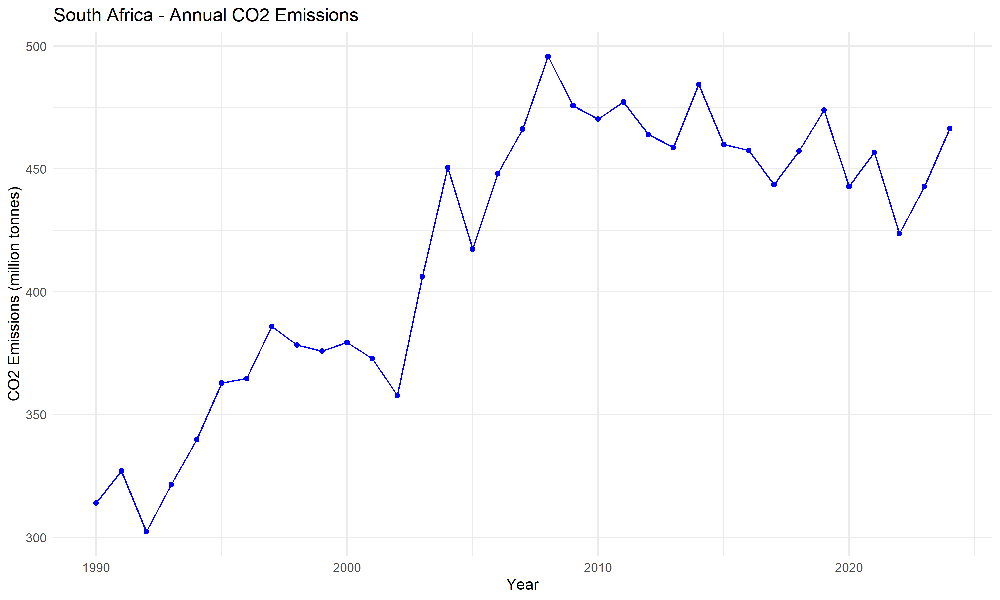

# CO₂ Emissions Analysis: South Africa

## Introduction

Carbon dioxide (CO₂) emissions are one of the major contributors to climate change. Understanding how emissions change over time helps us examine a country's contribution to global environmental challenges.

This study examines the annual CO₂ emissions and CO₂ emissions per capita of South Africa from 1990 to 2024 using data from Our World in Data.

## Research Question

How have annual CO₂ emissions and per-capita emissions changed in South Africa from 1990 to 2024?

## Objectives

- Examine the changes in annual CO₂ emissions in South Africa.
- Analyze the changes in CO₂ emissions per capita.
- Present the trends through graphical visualizations.

## Study Area

**Country:** South Africa  
**ISO Code:** ZAF  
**Study Period:** 1990–2024

## Data Source

The dataset was obtained from Our World in Data:

[Our World in Data – CO₂ and Greenhouse Gas Emissions](https://github.com/owid/co2-data)

## Variables Analyzed

- Annual CO₂ emissions
- CO₂ emissions per capita
- Year

## Methodology

The dataset was downloaded and processed using RStudio. The data were filtered to include South Africa from 1990 to 2024. The analysis focused on examining changes in annual CO₂ emissions and per-capita emissions. Graphs were created using the `ggplot2` package in R.

## Results and Visualizations

### 1. Annual CO₂ Emissions

### 2. CO₂ Emissions Per Capita

## Project Files

- `data/` – Original and filtered datasets
- `figures/` – Generated graphs
- `results/` – Summary statistics
- `scripts/` – R analysis script

## Tools Used

- R
- RStudio
- ggplot2
- dplyr
- readr
- GitHub

## Author

**Maria Shamicah T. Miraflor**
