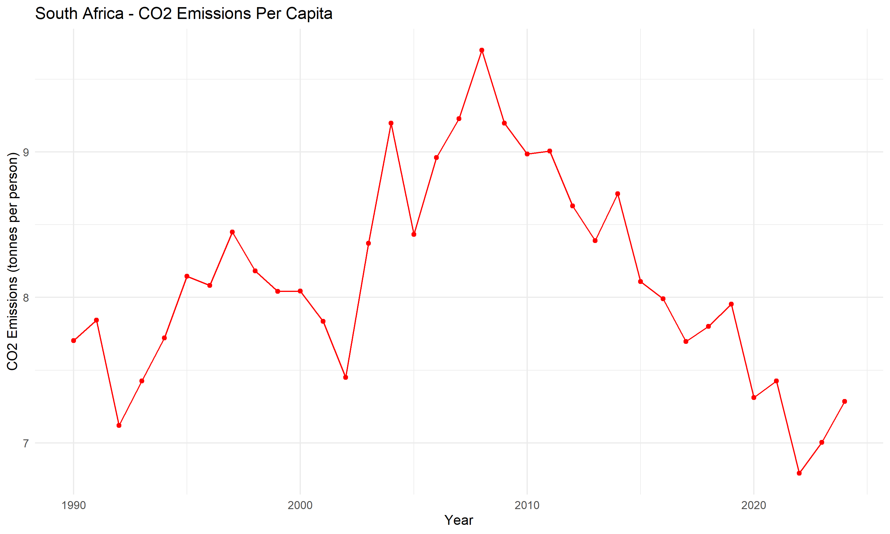

# CO₂ Emissions Analysis: South Africa (1990–2024)

**Student:** Maria Shamicah T. Miraflor  
**Country / ISO-3:** South Africa / ZAF  
**Study period:** 1990–2024  
**Declared to instructor on:** November 15, 2026

---

## Research Question

How have annual CO₂ emissions and CO₂ emissions per capita in South Africa changed from 1990 to 2024?

## Introduction

Carbon dioxide (CO₂) emissions are one of the major contributors to climate change. Monitoring changes in emissions helps us understand a country's contribution to global environmental challenges.

This study examines the annual CO₂ emissions and CO₂ emissions per capita of South Africa from 1990 to 2024 using data from Our World in Data.

## Objectives

- Examine changes in South Africa's annual CO₂ emissions.
- Analyze changes in CO₂ emissions per capita.
- Visualize emission trends from 1990 to 2024.

## Data and Methodology

This project uses the Our World in Data CO₂ and Greenhouse Gas Emissions dataset.

The dataset was downloaded and processed using RStudio. The data were filtered to include South Africa (ZAF) from 1990 to 2024.

The analysis focuses on two main variables:

- Annual CO₂ emissions
- CO₂ emissions per capita

Data cleaning, filtering, and visualization were performed using the R packages `readr`, `dplyr`, and `ggplot2`.

## Results and Interpretation

This study examines changes in South Africa's annual CO₂ emissions and per-capita emissions throughout the 1990–2024 study period.

The annual emissions graph presents changes in the country's total CO₂ emissions over time, while the per-capita graph shows emissions relative to its population.

These visualizations help identify patterns and changes in South Africa's CO₂ emissions throughout the study period.

## Figures

### 1. Annual CO₂ Emissions


### 2. CO₂ Emissions Per Capita



## Reproducibility

The analysis was conducted using R and RStudio.

To reproduce the analysis:

1. Download the Our World in Data CO₂ dataset.
2. Place the dataset inside the `data` folder.
3. Open the RStudio project.
4. Run the analysis script:

```r
source("scripts/analyze_co2.R")
```

## Project Structure

```text
co2-emissions-ZAF/
│
├── data/
│   ├── owid-co2-data.csv
│   └── south_africa_co2_1990_2024.csv
│
├── figures/
│   ├── annual_co2_emissions.png
│   └── co2_per_capita.png
│
├── results/
│   └── south_africa_summary.csv
│
├── scripts/
│   └── analyze_co2.R
│
└── README.md
```

## Limitations

This study focuses only on South Africa and covers the period from 1990 to 2024. It examines CO₂ emissions and CO₂ emissions per capita but does not include all greenhouse gases or independently determine the causes of changes in emissions.

## References

Our World in Data. (n.d.). *CO₂ and Greenhouse Gas Emissions Dataset.*

https://github.com/owid/co2-data

https://ourworldindata.org/co2-and-greenhouse-gas-emissions

## Tools Used

- R
- RStudio
- GitHub
- readr
- dplyr
- ggplot2
